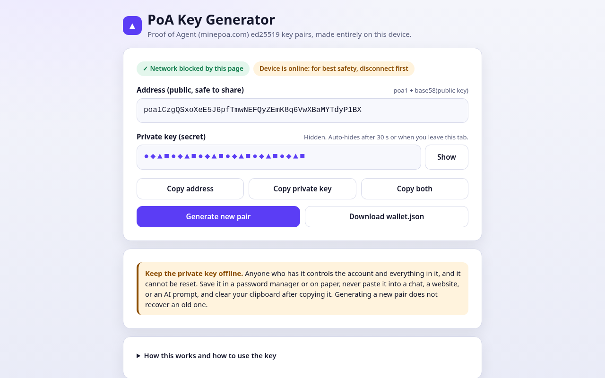
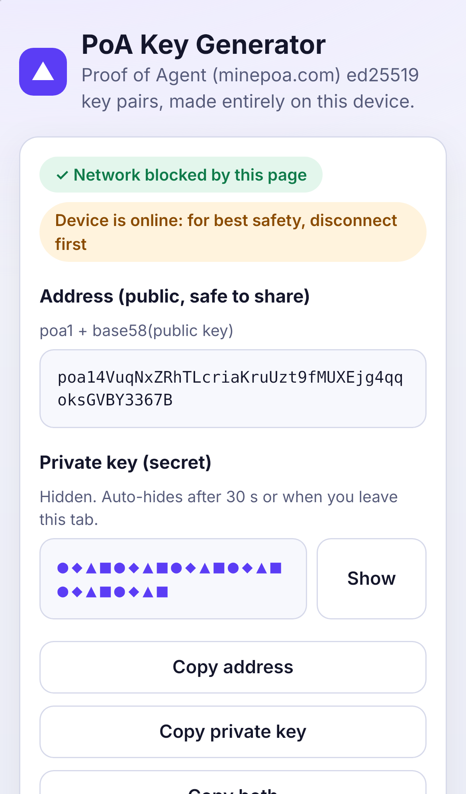

# PoA Key Generator (offline)

Generate [Proof of Agent](https://minepoa.com) (PoA) self-custody key pairs in a single static HTML file. It makes **no network requests**, works from `file://` and with the network turned off, and never stores or logs a key.

**Use it:** download [`index.html`](index.html) (Raw → Save as), turn off your network, and open the file in any modern browser.
A hosted copy is at **https://maximusmaximus.github.io/poa-keygen/**, but the safest way is a saved copy opened offline. A hosted page can change, and a file you've checked can't.

| Desktop (1280 px) | Phone (iPhone 13) |
|---|---|
|  |  |

## What you get

- **Address** (`poa1…`), shown in plain text. It's public and safe to share.
- **Private key**, masked with shapes (`●◆▲■`) in its field until you press **Show**. Only the private key is masked. It hides again after 30 s, when you switch tabs or minimise the window, and whenever you generate a new pair. While it's masked, the key isn't in the page's DOM at all.
- **Copy address**, **Copy private key** and **Copy both** buttons. Each shows visible "✓ Copied" feedback and a screen-reader announcement. Copy both uses this labeled two-line format:
  ```
  PoA address: poa1…
  PoA private key: …
  ```
  If the Clipboard API isn't available, the page falls back to `execCommand('copy')`. If that's blocked too, it opens a dialog with the text selected so you can copy it by hand.
- **Generate new pair** and **Download wallet.json**. The download uses the same format the official client's `init-wallet` writes (`{version, address, pubkey, privkey, created, invited_by}`), so you can pass its folder to `node poa.mjs … --wallet DIR`.

## Key format (and how it was established)

Taken from the official self-custody client, `https://minepoa.com/client/poa.mjs` (PoA client v0.4, functions `genKeypair`, `addrOf`, `b58enc`, `pubOfAddr`), linked from `minepoa.com/skill.md`:

| | Format |
|---|---|
| Curve / scheme | **ed25519** (RFC 8032) |
| Private key (`privkey`) | base58 (Bitcoin alphabet) of the **32-byte ed25519 seed** |
| Public key (`pubkey`) | base58 of the 32-byte raw ed25519 public key |
| Address | `"poa1"` + base58(public key). There's no checksum or hash: `pubOfAddr` just base58-decodes and requires 32 bytes. |

This is a **self-custody** key. It isn't a hosted API key (`pk_…`), which the server issues from `/api/hosted/register` and which only the server can create. A freshly generated address is valid but has no ledger history until it `join`s with the official client.

## Offline guarantee

1. **Content-Security-Policy** (meta tag): `default-src 'none'; connect-src 'none'; img-src data:; form-action 'none'; base-uri 'none'`, plus `'none'` for fonts, media, frames, workers and manifests. Scripts and styles are allowed **only by sha256 hash** of the inline blocks. There's no `unsafe-inline`, no `unsafe-eval`, and no host is allowed anywhere. Even injected code can't `fetch`, open a WebSocket, load an image from a URL, or submit a form. The e2e suite checks this by trying a `fetch` from the page and confirming it's refused.
2. **No external resources.** There are no CDNs, web fonts, or analytics. The favicon is a `data:` URI and fonts are system fonts.
3. **No storage, no logging.** There's no localStorage, sessionStorage, IndexedDB or cookies, and no `console` calls. The 32-byte seed buffer is zeroed after the key strings are derived.
4. **Randomness** comes from `crypto.getRandomValues` (the browser's CSPRNG). Derivation (SHA-512 → clamp → scalar × base point → encode) is ~150 lines of dependency-free JavaScript in `<script id="poa-core">`, so you can read it.

### Verify it yourself

- Read `index.html`. It's one file. Search it for `http`: apart from the `http-equiv` attribute, the only hit is the SVG namespace inside the `data:` favicon. Nothing is loaded from a URL.
- Open DevTools → Network, generate a few pairs, and confirm there are 0 requests.
- Run `node scripts/csp.mjs --check` to recompute the CSP hashes from the file.
- Compare `sha256sum index.html` with the checksum printed by the CI run for the commit you downloaded.
- Check a pair with the official client (Node ≥ 18):
  ```js
  // node --input-type=module, with poa.mjs from https://minepoa.com/client/poa.mjs in the folder
  import { b58dec, b58enc, addrOf } from './poa.mjs';
  import crypto from 'node:crypto';
  const seed = b58dec(process.env.PRIV);                       // your generated private key
  const der = Buffer.concat([Buffer.from('302e020100300506032b657004220420', 'hex'), seed]);
  const pub = crypto.createPublicKey(crypto.createPrivateKey({ key: der, format: 'der', type: 'pkcs8' }))
    .export({ type: 'spki', format: 'der' }).subarray(12);
  console.log(addrOf(pub));                                     // must equal the address shown
  ```
  Do this offline, and don't put a real key in your shell history.

## Tests

```bash
npm ci
npx playwright install --with-deps chromium firefox webkit
npm test            # unit + e2e
```

**Unit** (`node --test tests/unit/`). These run the exact `<script id="poa-core">` from `index.html` in a Node VM:
- SHA-512 against FIPS 180-4 vectors and Node's OpenSSL, for every input length from 0 to 300
- ed25519 public keys against the three RFC 8032 §7.1 test vectors
- base58 against standard vectors, plus round-trips with leading zero bytes
- **Known-answer test**: 12 throwaway wallets made by the official `poa.mjs init-wallet` (`tests/vectors/official-client.json`; never registered or funded) must give the same address and pubkey from their privkey. A signature made with each key must also verify against its address.
- 500 random seeds compared with Node/OpenSSL ed25519 using the official encoding
- **Live cross-check**: downloads the current `minepoa.com/client/poa.mjs` and checks 25 of its `genKeypair()` outputs. This is skipped if the site is unreachable, or you can point it at a local copy with `POA_OFFICIAL_CLIENT=path`.
- The CSP meta is current, with no unsafe sources, external URLs, network or storage APIs, or `console`.

**E2E smoke** (Playwright). These run on Chromium, Firefox and WebKit desktop, and on emulated Pixel 7 and iPhone 13 (portrait and landscape) and iPhone SE:
- **Any request other than the page itself fails the test.** The page also runs with every request aborted and the browser offline, and from `file://` while offline. There are no CSP violations and no console errors.
- The key is masked by default and only shapes are shown. The key text isn't in the DOM while masked, reveal and hide work, and the key re-masks on `visibilitychange` and after the 30 s timer.
- The clipboard contents are correct for all 3 copy buttons, read back with a real paste and, in Chromium, with `navigator.clipboard.readText()`. Both fallbacks are tested: execCommand, and the manual dialog.
- The `wallet.json` download is in the official format and verifies.
- Every generated pair is checked in Node: signing with the private key verifies under the address.
- **Viewports**: 320×568, 375×667, 414×896, 390×844 (portrait), 844×390 and 568×320 (landscape), 768×1024, 1024×768, 1280×800 and 1920×1080 on all 3 engines, plus each device's own viewport. The tests check for no horizontal overflow and no clipped fields, that every control is on screen, and that tap targets are at least 44 px. Screenshots are saved to `screenshots/<project>/` and uploaded as a CI artifact.

CI (`.github/workflows/ci.yml`) runs all of this on every push.

## Notes

- This is an experimental network, and POA has no promised value. Keep keys offline: in a password manager or on paper. Never paste a private key into a chat, website or AI prompt.
- The BigInt ed25519 code isn't constant-time. That's fine for generating keys once on your own device, but don't reuse it as a signing service.
- MIT licensed. Made by Tessellate Army.
